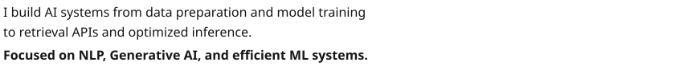
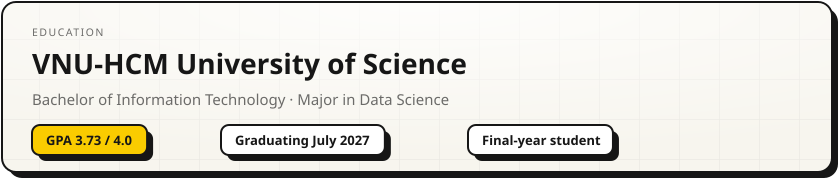
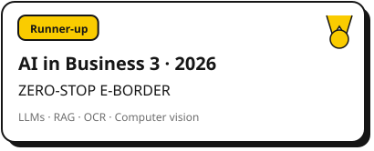
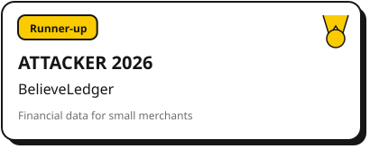
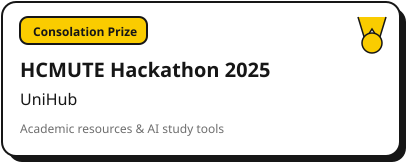
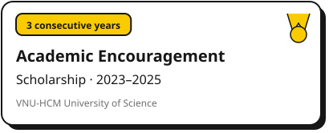
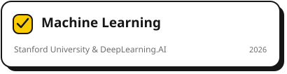
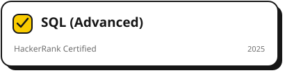
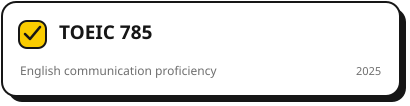
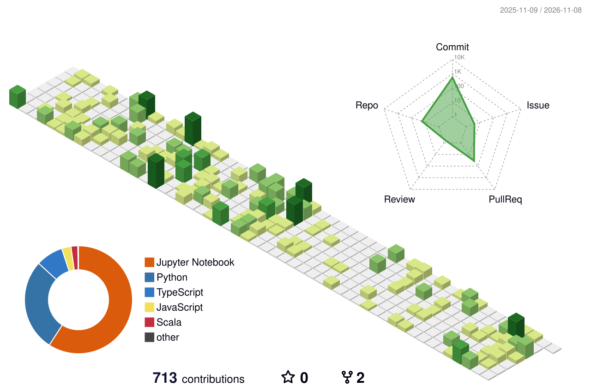

<picture><source media="(prefers-reduced-motion: reduce) and (prefers-color-scheme: dark)" srcset="assets/hero-dark-still.svg" /><source media="(prefers-reduced-motion: reduce)" srcset="assets/hero-light-still.svg" /><source media="(prefers-color-scheme: dark)" srcset="assets/hero-dark.svg" /></picture>

<a href="https://namviet-portfolio.vercel.app"><picture><source media="(prefers-reduced-motion: reduce) and (prefers-color-scheme: dark)" srcset="assets/btn-site-dark-still.svg" /><source media="(prefers-reduced-motion: reduce)" srcset="assets/btn-site-light-still.svg" /><source media="(prefers-color-scheme: dark)" srcset="assets/btn-site-dark.svg" /></picture></a>
<a href="https://namviet-portfolio.vercel.app/bui-nam-viet-resume.pdf"><picture><source media="(prefers-reduced-motion: reduce) and (prefers-color-scheme: dark)" srcset="assets/btn-resume-dark-still.svg" /><source media="(prefers-reduced-motion: reduce)" srcset="assets/btn-resume-light-still.svg" /><source media="(prefers-color-scheme: dark)" srcset="assets/btn-resume-dark.svg" /></picture></a>
<a href="https://www.linkedin.com/in/viet-bui-us23/"><picture><source media="(prefers-reduced-motion: reduce) and (prefers-color-scheme: dark)" srcset="assets/btn-linkedin-dark-still.svg" /><source media="(prefers-reduced-motion: reduce)" srcset="assets/btn-linkedin-light-still.svg" /><source media="(prefers-color-scheme: dark)" srcset="assets/btn-linkedin-dark.svg" /></picture></a>
<a href="mailto:bnviet05@gmail.com"><picture><source media="(prefers-reduced-motion: reduce) and (prefers-color-scheme: dark)" srcset="assets/btn-email-dark-still.svg" /><source media="(prefers-reduced-motion: reduce)" srcset="assets/btn-email-light-still.svg" /><source media="(prefers-color-scheme: dark)" srcset="assets/btn-email-dark.svg" /></picture></a>

<picture><source media="(prefers-reduced-motion: reduce) and (prefers-color-scheme: dark)" srcset="assets/intro-dark-still.svg" /><source media="(prefers-reduced-motion: reduce)" srcset="assets/intro-light-still.svg" /><source media="(prefers-color-scheme: dark)" srcset="assets/intro-dark.svg" /></picture>

 

<picture><source media="(prefers-reduced-motion: reduce) and (prefers-color-scheme: dark)" srcset="assets/experience-dark-still.svg" /><source media="(prefers-reduced-motion: reduce)" srcset="assets/experience-light-still.svg" /><source media="(prefers-color-scheme: dark)" srcset="assets/experience-dark.svg" /></picture>

 

<picture><source media="(prefers-reduced-motion: reduce) and (prefers-color-scheme: dark)" srcset="assets/work-head-dark-still.svg" /><source media="(prefers-reduced-motion: reduce)" srcset="assets/work-head-light-still.svg" /><source media="(prefers-color-scheme: dark)" srcset="assets/work-head-dark.svg" /></picture>
<a href="https://github.com/namviet157/ScholarHub"><picture><source media="(prefers-reduced-motion: reduce) and (prefers-color-scheme: dark)" srcset="assets/work-scholarhub-dark-still.svg" /><source media="(prefers-reduced-motion: reduce)" srcset="assets/work-scholarhub-light-still.svg" /><source media="(prefers-color-scheme: dark)" srcset="assets/work-scholarhub-dark.svg" /></picture></a>
<a href="https://github.com/TourismTogether/ai-service"><picture><source media="(prefers-reduced-motion: reduce) and (prefers-color-scheme: dark)" srcset="assets/work-tourism-dark-still.svg" /><source media="(prefers-reduced-motion: reduce)" srcset="assets/work-tourism-light-still.svg" /><source media="(prefers-color-scheme: dark)" srcset="assets/work-tourism-dark.svg" /></picture></a>
<a href="https://github.com/namviet157/HyperNetworks"><picture><source media="(prefers-reduced-motion: reduce) and (prefers-color-scheme: dark)" srcset="assets/work-hypernetworks-dark-still.svg" /><source media="(prefers-reduced-motion: reduce)" srcset="assets/work-hypernetworks-light-still.svg" /><source media="(prefers-color-scheme: dark)" srcset="assets/work-hypernetworks-dark.svg" /></picture></a>
<a href="https://github.com/namviet157/music-recommendation-system"><picture><source media="(prefers-reduced-motion: reduce) and (prefers-color-scheme: dark)" srcset="assets/work-music-dark-still.svg" /><source media="(prefers-reduced-motion: reduce)" srcset="assets/work-music-light-still.svg" /><source media="(prefers-color-scheme: dark)" srcset="assets/work-music-dark.svg" /></picture></a>

 

<picture><source media="(prefers-reduced-motion: reduce) and (prefers-color-scheme: dark)" srcset="assets/stack-dark-still.svg" /><source media="(prefers-reduced-motion: reduce)" srcset="assets/stack-light-still.svg" /><source media="(prefers-color-scheme: dark)" srcset="assets/stack-dark.svg" /></picture>

<picture><source media="(prefers-reduced-motion: reduce) and (prefers-color-scheme: dark)" srcset="assets/recognition-head-dark-still.svg" /><source media="(prefers-reduced-motion: reduce)" srcset="assets/recognition-head-light-still.svg" /><source media="(prefers-color-scheme: dark)" srcset="assets/recognition-head-dark.svg" /></picture>

<picture><source media="(prefers-reduced-motion: reduce) and (prefers-color-scheme: dark)" srcset="assets/education-dark-still.svg" /><source media="(prefers-reduced-motion: reduce)" srcset="assets/education-light-still.svg" /><source media="(prefers-color-scheme: dark)" srcset="assets/education-dark.svg" /></picture>

<a href="https://namviet-portfolio.vercel.app/awards/zero-stop-e-border"><picture><source media="(prefers-reduced-motion: reduce) and (prefers-color-scheme: dark)" srcset="assets/award-aib-dark-still.svg" /><source media="(prefers-reduced-motion: reduce)" srcset="assets/award-aib-light-still.svg" /><source media="(prefers-color-scheme: dark)" srcset="assets/award-aib-dark.svg" /></picture></a>
<a href="https://namviet-portfolio.vercel.app/awards/believeledger"><picture><source media="(prefers-reduced-motion: reduce) and (prefers-color-scheme: dark)" srcset="assets/award-attacker-dark-still.svg" /><source media="(prefers-reduced-motion: reduce)" srcset="assets/award-attacker-light-still.svg" /><source media="(prefers-color-scheme: dark)" srcset="assets/award-attacker-dark.svg" /></picture></a>
<a href="https://namviet-portfolio.vercel.app/awards/unihub"><picture><source media="(prefers-reduced-motion: reduce) and (prefers-color-scheme: dark)" srcset="assets/award-hackathon-dark-still.svg" /><source media="(prefers-reduced-motion: reduce)" srcset="assets/award-hackathon-light-still.svg" /><source media="(prefers-color-scheme: dark)" srcset="assets/award-hackathon-dark.svg" /></picture></a>
<picture><source media="(prefers-reduced-motion: reduce) and (prefers-color-scheme: dark)" srcset="assets/award-scholarship-dark-still.svg" /><source media="(prefers-reduced-motion: reduce)" srcset="assets/award-scholarship-light-still.svg" /><source media="(prefers-color-scheme: dark)" srcset="assets/award-scholarship-dark.svg" /></picture>

<a href="https://coursera.org/share/e10d011678f775632feb65a21465f45c"><picture><source media="(prefers-reduced-motion: reduce) and (prefers-color-scheme: dark)" srcset="assets/cert-ml-dark-still.svg" /><source media="(prefers-reduced-motion: reduce)" srcset="assets/cert-ml-light-still.svg" /><source media="(prefers-color-scheme: dark)" srcset="assets/cert-ml-dark.svg" /></picture></a>
<a href="https://coursera.org/share/0bbaae18e9e1d2674dd7bfa9580eae3e"><picture><source media="(prefers-reduced-motion: reduce) and (prefers-color-scheme: dark)" srcset="assets/cert-google-dark-still.svg" /><source media="(prefers-reduced-motion: reduce)" srcset="assets/cert-google-light-still.svg" /><source media="(prefers-color-scheme: dark)" srcset="assets/cert-google-dark.svg" /></picture></a>
<a href="https://www.hackerrank.com/certificates/0d15281fdd07"><picture><source media="(prefers-reduced-motion: reduce) and (prefers-color-scheme: dark)" srcset="assets/cert-sql-dark-still.svg" /><source media="(prefers-reduced-motion: reduce)" srcset="assets/cert-sql-light-still.svg" /><source media="(prefers-color-scheme: dark)" srcset="assets/cert-sql-dark.svg" /></picture></a>
<picture><source media="(prefers-reduced-motion: reduce) and (prefers-color-scheme: dark)" srcset="assets/cert-toeic-dark-still.svg" /><source media="(prefers-reduced-motion: reduce)" srcset="assets/cert-toeic-light-still.svg" /><source media="(prefers-color-scheme: dark)" srcset="assets/cert-toeic-dark.svg" /></picture>

 

<a href="mailto:bnviet05@gmail.com"><picture><source media="(prefers-reduced-motion: reduce) and (prefers-color-scheme: dark)" srcset="assets/footer-dark-still.svg" /><source media="(prefers-reduced-motion: reduce)" srcset="assets/footer-light-still.svg" /><source media="(prefers-color-scheme: dark)" srcset="assets/footer-dark.svg" /></picture></a>

<picture><source media="(prefers-reduced-motion: reduce) and (prefers-color-scheme: dark)" srcset="assets/activity-label-dark-still.svg" /><source media="(prefers-reduced-motion: reduce)" srcset="assets/activity-label-light-still.svg" /><source media="(prefers-color-scheme: dark)" srcset="assets/activity-label-dark.svg" /></picture>

