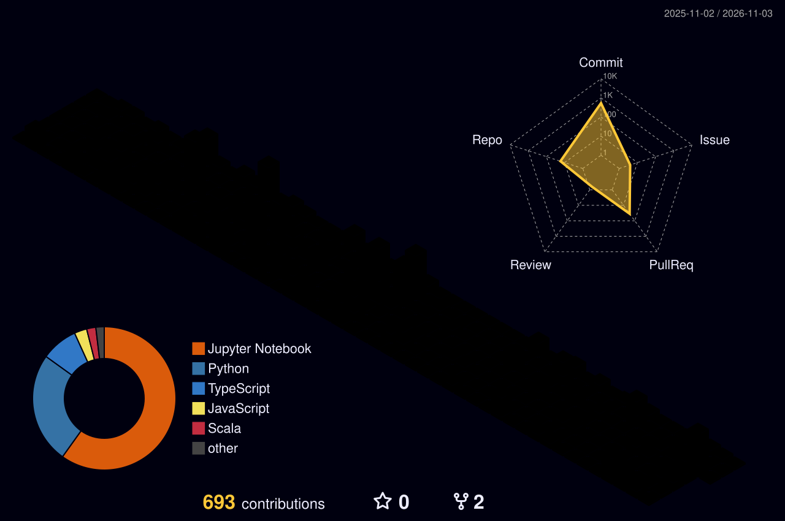

<picture><source media="(prefers-reduced-motion: reduce) and (prefers-color-scheme: dark)" srcset="assets/hero-dark-still.svg" /><source media="(prefers-reduced-motion: reduce)" srcset="assets/hero-light-still.svg" /><source media="(prefers-color-scheme: dark)" srcset="assets/hero-dark.svg" /></picture>

<a href="https://namviet-portfolio.vercel.app"><picture><source media="(prefers-reduced-motion: reduce) and (prefers-color-scheme: dark)" srcset="assets/btn-site-dark-still.svg" /><source media="(prefers-reduced-motion: reduce)" srcset="assets/btn-site-light-still.svg" /><source media="(prefers-color-scheme: dark)" srcset="assets/btn-site-dark.svg" /></picture></a>
<a href="https://namviet-portfolio.vercel.app/bui-nam-viet-resume.pdf"><picture><source media="(prefers-reduced-motion: reduce) and (prefers-color-scheme: dark)" srcset="assets/btn-resume-dark-still.svg" /><source media="(prefers-reduced-motion: reduce)" srcset="assets/btn-resume-light-still.svg" /><source media="(prefers-color-scheme: dark)" srcset="assets/btn-resume-dark.svg" /></picture></a>
<a href="https://www.linkedin.com/in/viet-bui-us23/"><picture><source media="(prefers-reduced-motion: reduce) and (prefers-color-scheme: dark)" srcset="assets/btn-linkedin-dark-still.svg" /><source media="(prefers-reduced-motion: reduce)" srcset="assets/btn-linkedin-light-still.svg" /><source media="(prefers-color-scheme: dark)" srcset="assets/btn-linkedin-dark.svg" /></picture></a>
<a href="mailto:bnviet05@gmail.com"><picture><source media="(prefers-reduced-motion: reduce) and (prefers-color-scheme: dark)" srcset="assets/btn-email-dark-still.svg" /><source media="(prefers-reduced-motion: reduce)" srcset="assets/btn-email-light-still.svg" /><source media="(prefers-color-scheme: dark)" srcset="assets/btn-email-dark.svg" /></picture></a>

I build AI systems from data preparation and model training to retrieval APIs and optimized inference. My focus is **NLP, Generative AI, and efficient ML systems**.

 

<picture><source media="(prefers-reduced-motion: reduce) and (prefers-color-scheme: dark)" srcset="assets/experience-dark-still.svg" /><source media="(prefers-reduced-motion: reduce)" srcset="assets/experience-light-still.svg" /><source media="(prefers-color-scheme: dark)" srcset="assets/experience-dark.svg" /></picture>

 

<picture><source media="(prefers-reduced-motion: reduce) and (prefers-color-scheme: dark)" srcset="assets/work-head-dark-still.svg" /><source media="(prefers-reduced-motion: reduce)" srcset="assets/work-head-light-still.svg" /><source media="(prefers-color-scheme: dark)" srcset="assets/work-head-dark.svg" /></picture>
<a href="https://github.com/namviet157/ScholarHub"><picture><source media="(prefers-reduced-motion: reduce) and (prefers-color-scheme: dark)" srcset="assets/work-scholarhub-dark-still.svg" /><source media="(prefers-reduced-motion: reduce)" srcset="assets/work-scholarhub-light-still.svg" /><source media="(prefers-color-scheme: dark)" srcset="assets/work-scholarhub-dark.svg" /></picture></a>
<a href="https://github.com/TourismTogether/ai-service"><picture><source media="(prefers-reduced-motion: reduce) and (prefers-color-scheme: dark)" srcset="assets/work-tourism-dark-still.svg" /><source media="(prefers-reduced-motion: reduce)" srcset="assets/work-tourism-light-still.svg" /><source media="(prefers-color-scheme: dark)" srcset="assets/work-tourism-dark.svg" /></picture></a>
<a href="https://github.com/namviet157/HyperNetworks"><picture><source media="(prefers-reduced-motion: reduce) and (prefers-color-scheme: dark)" srcset="assets/work-hypernetworks-dark-still.svg" /><source media="(prefers-reduced-motion: reduce)" srcset="assets/work-hypernetworks-light-still.svg" /><source media="(prefers-color-scheme: dark)" srcset="assets/work-hypernetworks-dark.svg" /></picture></a>
<a href="https://github.com/namviet157/music-recommendation-system"><picture><source media="(prefers-reduced-motion: reduce) and (prefers-color-scheme: dark)" srcset="assets/work-music-dark-still.svg" /><source media="(prefers-reduced-motion: reduce)" srcset="assets/work-music-light-still.svg" /><source media="(prefers-color-scheme: dark)" srcset="assets/work-music-dark.svg" /></picture></a>

 

<picture><source media="(prefers-reduced-motion: reduce) and (prefers-color-scheme: dark)" srcset="assets/stack-dark-still.svg" /><source media="(prefers-reduced-motion: reduce)" srcset="assets/stack-light-still.svg" /><source media="(prefers-color-scheme: dark)" srcset="assets/stack-dark.svg" /></picture>

### Background & recognition

- **HCMUS:** Bachelor of Information Technology, major in Data Science · **GPA 3.73/4.0** · Expected graduation: July 2027.
- **Runner-up:** AI in Business 3 (2026), ZERO-STOP E-BORDER; ATTACKER 2026, BelieveLedger.
- **Consolation Prize:** HCMUTE Hackathon 2025, UniHub.
- **Academic Encouragement Scholarship:** Three consecutive years, 2023–2025.
- **Certifications:** [Machine Learning — Stanford & DeepLearning.AI](https://coursera.org/share/e10d011678f775632feb65a21465f45c), [Google Data Analytics](https://coursera.org/share/0bbaae18e9e1d2674dd7bfa9580eae3e), [SQL (Advanced)](https://www.hackerrank.com/certificates/0d15281fdd07) · TOEIC 785.

 

<a href="mailto:bnviet05@gmail.com"><picture><source media="(prefers-reduced-motion: reduce) and (prefers-color-scheme: dark)" srcset="assets/footer-dark-still.svg" /><source media="(prefers-reduced-motion: reduce)" srcset="assets/footer-light-still.svg" /><source media="(prefers-color-scheme: dark)" srcset="assets/footer-dark.svg" /></picture></a>

GitHub activity

